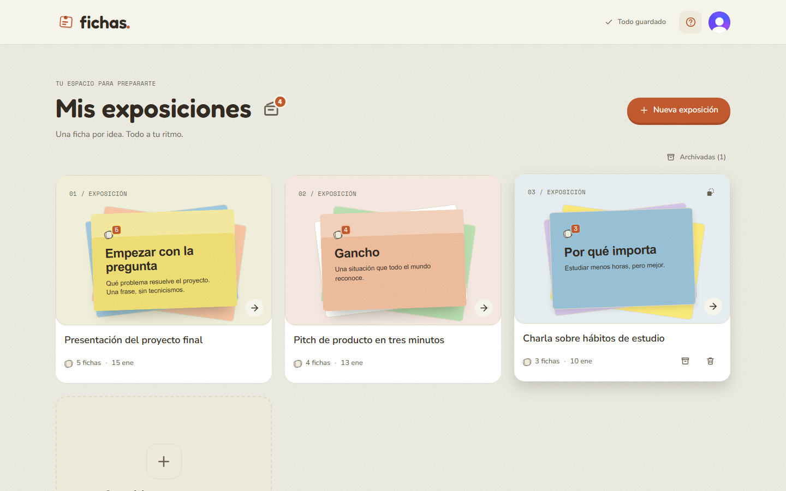
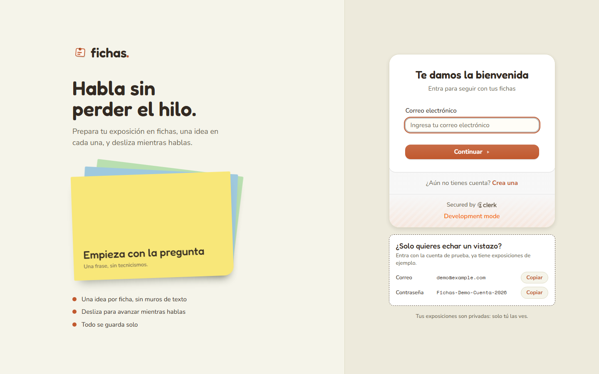
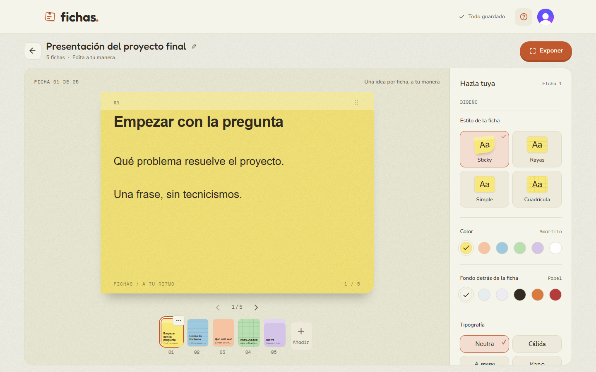
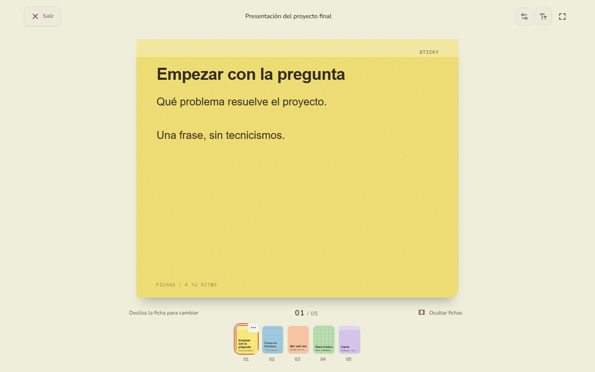
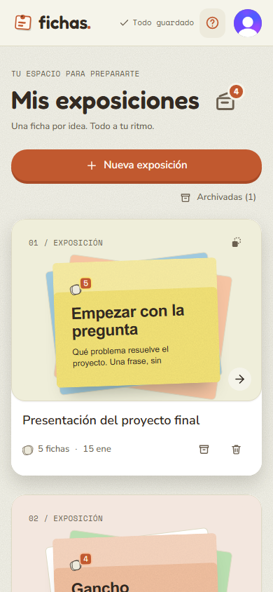
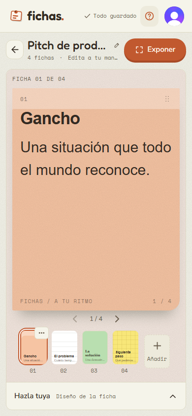
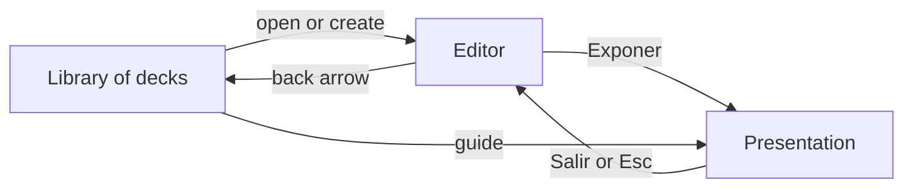
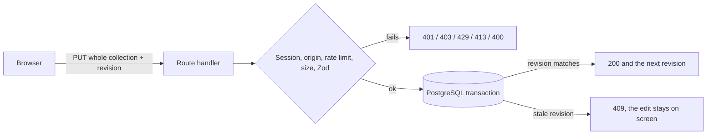

# Fichas

[](https://github.com/XavierQuirico/fichas/actions/workflows/ci.yml)

Prepare a talk on index cards, then present it by swiping from one card to the next. The interface is in Spanish.

**Live demo:** https://fichas-murex.vercel.app



## Why I made it

I have seen a lot of people struggle with paper cards while they give a talk, and it has happened to me too. When you have many cards you have to pass them one by one, and they get mixed up or they fall. Others fill every card with so much text that, once they start talking, they can't find where they were.

I looked for an app that solved this and I couldn't find one. So I decided to build it myself.

Fichas is built around three ideas:

- **One idea per card.** Less to read while you speak.
- **You control how each card looks.** Style, colour, background, typography and text size.
- **Presenting is just swiping.** You talk, you swipe, and you always see where you are in the deck.

Your decks live in one place. You keep them, archive them or delete them.

## Try it

| Account       | Email                 | Password                     |
| ------------- | --------------------- | ---------------------------- |
| Demo          | `demo@example.com`    | `Fichas-Demo-Cuenta-2026`    |
| Second (test) | `segunda@example.com` | `Fichas-Segunda-Cuenta-2026` |

These are made-up accounts with sample decks, shared on purpose. The second one is there to check that two accounts never see each other's decks. You can also sign up with your own email. The demo runs on a Clerk development instance, so Clerk shows a "Development mode" label.

|                                                    |                                                                                                                                                                                 |
| -------------------------------------------------- | ------------------------------------------------------------------------------------------------------------------------------------------------------------------------------- |
|            |                                                                                                                                       |
|  |   |

## What it does

- Create decks and cards, and choose a style, a colour, a background and a typography for each card.
- Everything saves on its own. The top bar tells you when the last change has reached the server.
- Present a deck full screen: drag the card away, use the keyboard, or jump with the thumbnails.
- Archive and duplicate decks, reorder cards by holding and dragging, undo a deleted card.
- Each account only sees its own decks.



## Where I want to take it

This is the first version, and there is a lot I haven't done yet. What I want next:

- More life: animations, micro-interactions, transitions and icons that react.
- A guided first run and a better home screen, so a new person knows what to do in seconds.
- Presenting without a connection.
- Open it to everyone on the web, and publish it in the Play Store and the App Store.

## How it works



Each autosave sends the whole collection with the revision the client last saw. The server locks the account's row, compares the revision and applies the change in one transaction. It is simple and decks are small, but it is not a diff: every save resends everything. The autosave sequence, the data model and the order of checks are in [docs/ARCHITECTURE.md](docs/ARCHITECTURE.md) and [docs/API.md](docs/API.md).

## Project structure

```text
app/            pages, API routes, layout and the stylesheet
  api/          the workspace, archive and card-fonts route handlers
  styles/       the stylesheet, split by screen (kept in source order)
components/
  auth/         the frame around the sign-in and sign-up forms
  ui/           shadcn/ui primitives
  workspace/    library, editor, presentation and their parts
db/             Drizzle schema and the connection pool
docs/           architecture and API notes, screenshots
drizzle/        SQL migrations
e2e/            Playwright tests
hooks/          autosave, gestures, fullscreen, preferences
lib/            shared code: cards, fonts, limits, Clerk text and theme
  server/       server-only code: auth, repository, schemas, rate limit, headers
public/         fonts and favicon
scripts/        dev server wrapper and the demo seed
tests/          unit, API and component tests
vendor/         a vendored stylesheet with its licence
```

## Stack

- Next.js 16 (App Router), React 19 and TypeScript
- Tailwind CSS 4, shadcn/ui, Radix UI, Sonner and Lucide icons
- Clerk for sign-in
- PostgreSQL through `pg`, with Drizzle ORM for the schema and migrations, and Zod for validation
- `node:test`, Vitest with Testing Library, and Playwright
- pnpm 11, ESLint, Prettier and GitHub Actions
- Docker Compose for the local database; Vercel and Neon for the demo

## Run it locally

You need Node.js 22+, pnpm 11 and Docker.

```bash
pnpm install
cp .env.example .env
pnpm db:up
pnpm db:migrate
pnpm dev
```

Open http://localhost:3000. With `AUTH_MODE=demo` (the default in `.env.example`) the app signs in a fixed local user, so you can try it without a Clerk account. A production server refuses that mode on purpose. `pnpm db:seed` loads the sample decks (see `scripts/seed-demo.ts`).

For real sign-in, create a Clerk application and set `AUTH_MODE=clerk`, `NEXT_PUBLIC_CLERK_PUBLISHABLE_KEY` and `CLERK_SECRET_KEY` in `.env`. On serverless hosts set `DATABASE_POOL_MAX` to a small number (1 to 3). To show the demo account on the sign-in screen, set `NEXT_PUBLIC_DEMO_EMAIL` and `NEXT_PUBLIC_DEMO_PASS`; leave them out and nothing is shown.

## Tests

```bash
pnpm lint && pnpm typecheck
pnpm test               # unit tests
pnpm test:integration   # API routes against Postgres (run pnpm db:migrate first)
pnpm test:components    # components and hooks
pnpm e2e                # Playwright, starts next dev on port 3100
```

What I measured on the last run:

| Layer               | Tests | What it covers                                                                    |
| ------------------- | ----- | --------------------------------------------------------------------------------- |
| Unit (`node:test`)  | 39    | schemas, origin check, rate limiter, headers, gestures, auth, seed data           |
| API (real Postgres) | 18    | 401, 403, 400, 404, 409, 413 and 429 on the three routes, and account isolation   |
| Components (Vitest) | 35    | top bar, sign-in frame, library, filmstrip, dialogs, editor limits, autosave      |
| End to end          | 19    | create, edit, autosave, reload, archive, typography, present, swipe, phone layout |

Coverage is 96.7% of lines (90.9% of branches) for `lib/`, `app/api/` and `db/`. For `components/workspace/` and `hooks/` the component tests alone reach 24.7% of lines. The large `workspace.tsx`, which wires everything together, is only exercised by the end-to-end tests, and I do not measure those.

CI runs formatting, lint, typecheck, `pnpm audit --prod` (no known vulnerabilities), both coverage runs, the build and the end-to-end tests, with a Postgres service container.

Testing and a review turned up real bugs that are fixed here: saving the collection failed against a real database (the deck timestamp key did not match the SQL); choosing a typography right after creating a card failed because the card was not saved yet; edits typed during a slow save stayed "pending" and were never sent; a card with a NUL character or half an emoji made every later save fail; a failed read could return a broken connection to the pool; and the request size cap did not hold for chunked uploads.

## What's not done

- **No export or deletion of an account.** Deleting a user in Clerk leaves their rows in the database.
- **No offline mode, no native app, no public API or webhooks.** The routes are for this interface only.
- **The rate limiter is per server instance.** It lives in memory, so on serverless it limits each instance, not the whole service. A shared store would fix that.
- **The Content Security Policy keeps `'unsafe-inline'`** for scripts, because Next.js injects inline scripts. A nonce would remove it but would make every page dynamic.
- **Every save sends the whole collection.** Fine for small decks, wasteful for big ones.
- **The stylesheet is split by area but not reorganised.** Later rules override earlier ones, so I kept the original order rather than risk changing the design.
- **The interface is Spanish only**, and I have only tested it in Chromium.
- **The end-to-end tests run in demo mode**, not through Clerk. I checked the real sign-up and sign-in flow on the deployed demo with a real browser, outside the test suite.
- **I have not run a full accessibility audit.**

## More

- [Architecture](docs/ARCHITECTURE.md)
- [HTTP API](docs/API.md)
- [Security](SECURITY.md)

## Licence

All rights reserved, see [LICENSE](LICENSE). The bundled fonts and the vendored shadcn stylesheet keep their own licences.
