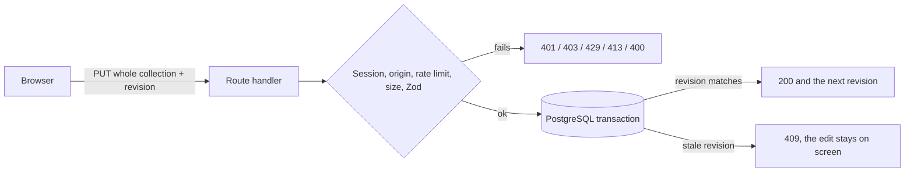

# Fichas

[](https://github.com/XavierQuirico/fichas/actions/workflows/ci.yml)

Fichas is a web app for preparing a talk on index cards and presenting it one card at a time. The interface is in Spanish.

I built it to practise shipping a whole product on my own: sign-in, a real database, autosave that does not lose edits, and tests I trust. A card per idea is also a better way to prepare a talk than reading from slides.

**Live demo:** https://fichas-murex.vercel.app

| Account       | Email                 | Password                     |
| ------------- | --------------------- | ---------------------------- |
| Demo          | `demo@example.com`    | `Fichas-Demo-Cuenta-2026`    |
| Second (test) | `segunda@example.com` | `Fichas-Segunda-Cuenta-2026` |

These are fictional accounts with sample data, shared on purpose. The second one is there to check that two accounts never see each other's decks. You can also sign up with your own email. The demo uses a Clerk development instance, so you will see a "Development mode" label.


|                                            |                                                    |
| ------------------------------------------ | -------------------------------------------------- |
|  |  |

 

## What it does

- Create decks and cards. Pick a style, a colour, a background and a typography for each card.
- Everything saves on its own. The top bar says when the last change has reached the server.
- Present a deck full screen: drag the card away, use the keyboard, or jump with the thumbnails.
- Archive and duplicate decks, reorder cards by holding and dragging, undo a deleted card.
- Each account only sees its own decks.

## How it works



Each autosave sends the whole collection with the revision the client last saw. The server locks the account's row, compares the revision and applies the change in one transaction. That is simple and the collections are small, but it is not a diff: every save resends everything. The autosave sequence, the data model and the order of checks are in [docs/ARCHITECTURE.md](docs/ARCHITECTURE.md) and [docs/API.md](docs/API.md).

## Stack

- Next.js 16 (App Router), React 19, TypeScript
- Clerk for sign-in
- PostgreSQL through `pg`, with Drizzle ORM for the schema and migrations
- pnpm 11 and Node.js 22 or later

## Run it locally

You need Node.js 22+, pnpm 11 and Docker.

```bash
pnpm install
cp .env.example .env
pnpm db:up
pnpm db:migrate
pnpm dev
```

Open http://localhost:3000. With `AUTH_MODE=demo` (the default in `.env.example`) the app signs in a fixed local user, so you can try it without a Clerk account. A production server refuses that mode on purpose. `pnpm db:seed` loads the sample decks (see `scripts/seed-demo.ts`).

For real sign-in, create a Clerk application and set `AUTH_MODE=clerk`, `NEXT_PUBLIC_CLERK_PUBLISHABLE_KEY` and `CLERK_SECRET_KEY` in `.env`. Set `DATABASE_POOL_MAX` to a small number (1 to 3) on serverless hosts.

## Tests

```bash
pnpm lint && pnpm typecheck
pnpm test               # unit tests
pnpm test:integration   # API routes against Postgres (run pnpm db:migrate first)
pnpm test:components    # components and hooks
pnpm e2e                # Playwright, starts next dev on port 3100
```

What I measured on the last run:

| Layer               | Tests | What it covers                                                                    |
| ------------------- | ----- | --------------------------------------------------------------------------------- |
| Unit (`node:test`)  | 25    | schemas, origin check, rate limiter, headers, gestures, auth, seed data           |
| API (real Postgres) | 17    | 401, 403, 400, 404, 409, 413 and 429 on the three routes, and account isolation   |
| Components (Vitest) | 23    | library, filmstrip, dialogs, editor limits, autosave and font hooks               |
| End to end          | 18    | create, edit, autosave, reload, archive, typography, present, swipe, phone layout |

Coverage is 96.2% of lines (89.9% of branches) for `lib/`, `app/api/` and `db/`. For `components/workspace/` and `hooks/` the component tests alone reach 36.3% of lines; the rest of the interface is exercised by the end-to-end tests, which I do not instrument.

CI runs formatting, lint, typecheck, `pnpm audit --prod` (no known vulnerabilities), both coverage runs, the build and the end-to-end tests, with a Postgres service container. The tests found two real bugs that are fixed here: saving the collection failed against a real database (the deck timestamp key did not match the SQL), and choosing a typography right after creating a card failed because the card was not saved yet.

## What's not done

- **No export or deletion of an account.** Deleting a user in Clerk leaves their rows in the database.
- **No offline mode, no native app, no public API or webhooks.** The routes are for this interface only.
- **The rate limiter is per server instance.** It lives in memory, so on serverless it limits each instance, not the whole service. A shared store would fix that.
- **The Content Security Policy keeps `'unsafe-inline'`** for scripts, because Next.js injects inline scripts. A nonce would remove it but would make every page dynamic.
- **Every save sends the whole collection.** Fine for small decks, wasteful for big ones.
- **The stylesheet is split by area but not reorganised.** Later rules override earlier ones, so I kept the original order rather than risk changing the design.
- **The interface is Spanish only**, and I have only tested it in Chromium.
- **The end-to-end tests run in demo mode**, not through Clerk. I checked the real sign-up and sign-in flow on the deployed demo with a real browser, outside the test suite.
- **I have not run a full accessibility audit.**

## More

- [Architecture](docs/ARCHITECTURE.md)
- [HTTP API](docs/API.md)
- [Security](SECURITY.md)

## Licence

All rights reserved, see [LICENSE](LICENSE). The bundled fonts and the vendored shadcn stylesheet keep their own licences.
