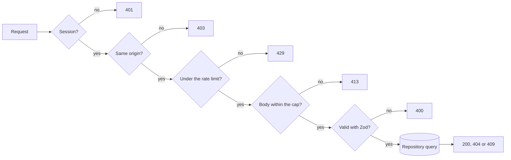
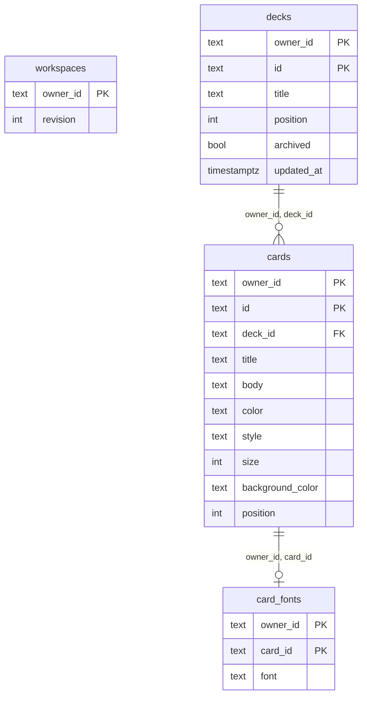

# Architecture

## In one line

```text
Browser -> Next.js route handler -> Clerk user id -> Postgres repository -> PostgreSQL
```

The web client talks to a plain HTTP contract (see [API.md](API.md)). Next.js runs as an ordinary Node.js server, and the data layer does not depend on any hosting provider.

## A write request



The handlers in `app/api/*/route.ts` run these steps in this order. Reads only check the session and then query.

## Identity and ownership

- Clerk verifies the session on the server (`lib/auth.ts`).
- Every handler takes the owner from that session. It never reads an owner id from the body, the query string or a header.
- Every query includes the owner, and the foreign keys carry it as well.
- Demo mode exists for local development only. It signs in a fixed local user and fails closed when `NODE_ENV` is `production`.

## Data model



`workspaces` holds one row per owner with the revision used for the optimistic check. Deleting a deck deletes its cards, and deleting a card deletes its font. Check constraints repeat the Zod rules (colours, styles, size range, title and body length) so the database stays valid even if a bug gets past the API.

## Autosave

```mermaid
sequenceDiagram
  participant U as User
  participant C as Client (useWorkspaceSync)
  participant S as PUT /api/workspace
  participant D as PostgreSQL
  U->>C: edit a card
  C->>C: generation++, status "pending", wait 650 ms
  C->>S: { decks, revision }
  S->>D: BEGIN, lock the workspace row
  alt revision matches
    S->>D: upsert decks, delete missing cards, upsert cards, delete missing decks, revision + 1
    S->>D: COMMIT
    S-->>C: { revision }
    C->>C: status "saved" (or "pending" if the user kept typing)
  else revision is stale
    S->>D: ROLLBACK
    S-->>C: 409
    C->>C: status "error", the edit stays on screen
  end
```



- Each save sends the **whole** collection. It is simple and the collection is small, but it is not a diff.
- Edits made while a save is running are not lost: `generation` keeps counting, and when the save ends the hook schedules another one.
- `flush()` saves right now and says whether everything reached the server. Card fonts call it first and are not sent if it says no, because the server only stores a font for a card it already has.
- After a reload from the server, nothing counts as unsaved, so the browser stops asking before the tab closes.
- Reads use a `REPEATABLE READ` transaction so the revision and the content come from the same snapshot.

## Client structure

| Path                       | What it holds                                                          |
| -------------------------- | ---------------------------------------------------------------------- |
| `app/workspace-client.tsx` | Wires the hooks and the screens together and owns the deck operations  |
| `components/workspace/`    | The screens (library, editor, presentation), the dialogs and the parts |
| `hooks/`                   | Autosave, card fonts, archive, fullscreen, swipe gestures, preferences |
| `app/styles/`              | The stylesheet, split in source order                                  |

The stylesheet is split without reordering anything. Later rules override earlier ones, so moving rules between files could change the design.

## Environment and migrations

Tables are defined in `db/schema.ts` and versioned in `drizzle/`. Migrations are applied explicitly with `pnpm db:migrate`, never on startup.

The pool is created lazily from `DATABASE_URL`. `DATABASE_POOL_MAX` sets its size (default 10, at most 20). On a serverless host use a small value, such as 1 to 3, together with the provider's pooled connection string.

## Tests

| Layer      | Tool                          | Covers                                                              |
| ---------- | ----------------------------- | ------------------------------------------------------------------- |
| Unit       | `node:test`                   | schemas, origin check, rate limiter, headers, gestures, auth        |
| API        | `node:test` and real Postgres | the three routes: 401, 403, 400, 404, 409, 413, 429, isolation      |
| Components | Vitest and Testing Library    | library, filmstrip, dialogs, editor limits, autosave and fonts      |
| End to end | Playwright                    | create, edit, autosave, reload, archive, typography, present, swipe |

The Clerk SDK is replaced by a stub in the unit and API tests, and `lib/auth.ts` runs as shipped. The end-to-end tests run against `next dev` in demo mode.
